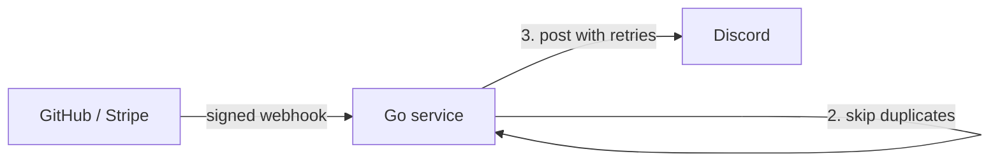

# Webhook Service

A small Go service that receives GitHub webhooks, verifies they are genuine, and posts a summary to Discord.

**Problem it solves:** webhooks can be faked, delivered twice, or fail when the chat service is down. This service rejects fake events, skips duplicates, and retries failed messages.

## How it works



## Features

- **Signature verification** (HMAC-SHA256): fake or tampered requests get `401`.
- **Idempotency:** each event ID is processed once; repeats are skipped.
- **Retries with backoff:** up to 3 attempts, waiting 1s then 2s.
- **Tests and CI:** unit tests run on every push via GitHub Actions.
- **Docker:** runs the same on any machine.

## Run it

```
docker build -t webhook-service .
docker run --rm -p 8080:8080 -e DISCORD_URL="your-discord-webhook-url" webhook-service
```

## Test it

```
go test -v
```

## Known limitations

- Processed event IDs are stored in memory, so they reset on restart. A production version would use a database or Redis.
- The signing secret is hardcoded for the demo. A production version would read it from an environment variable.
